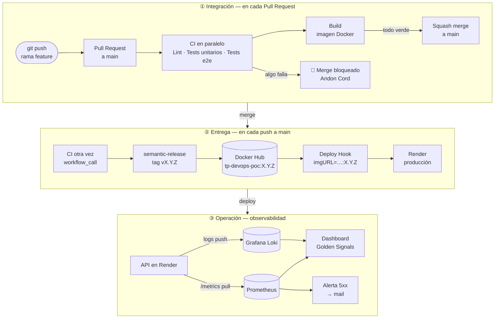
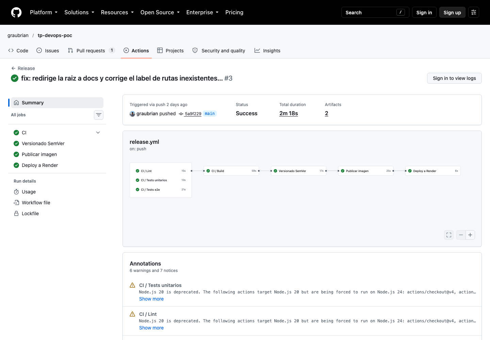
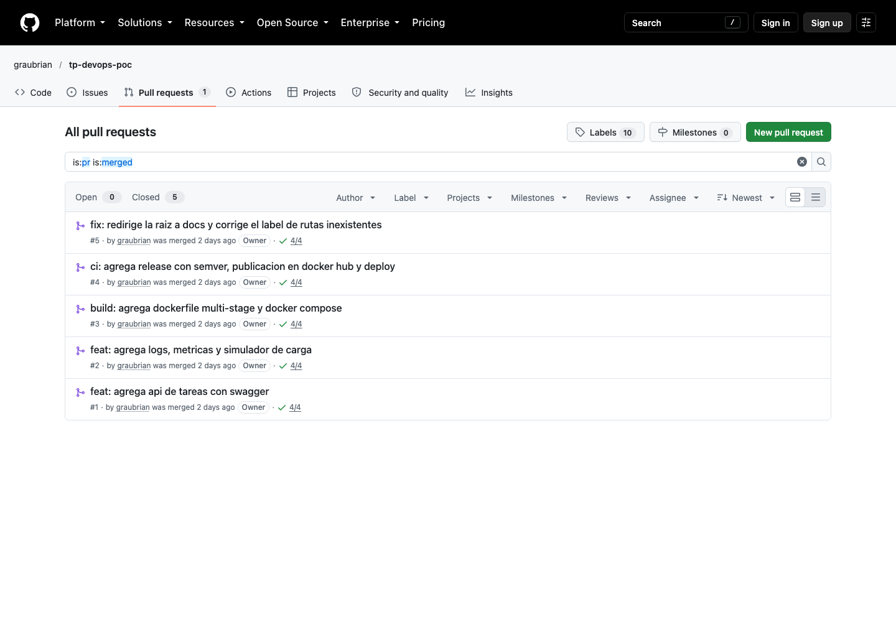
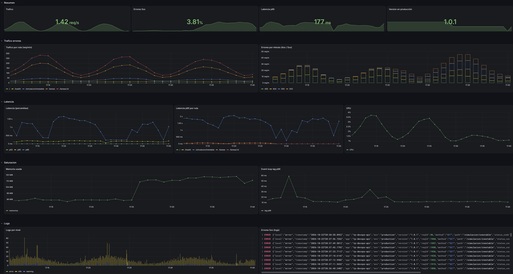
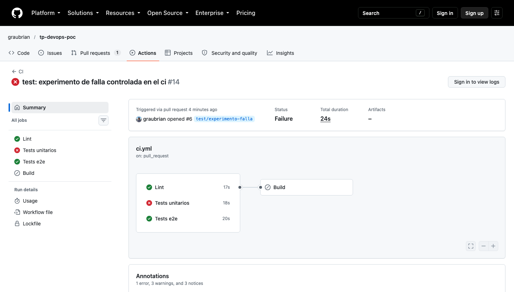
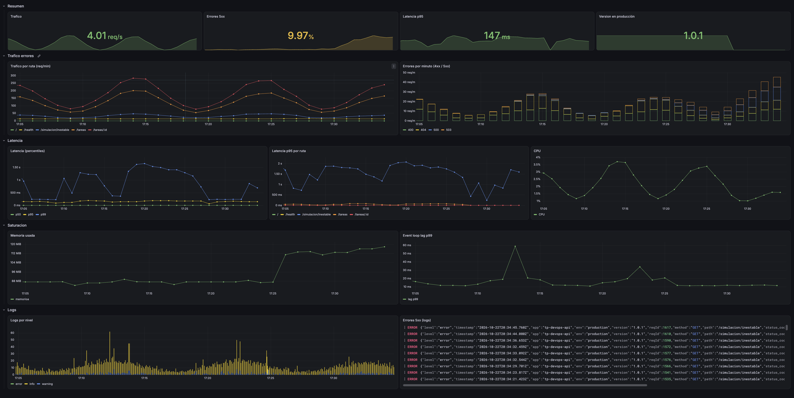
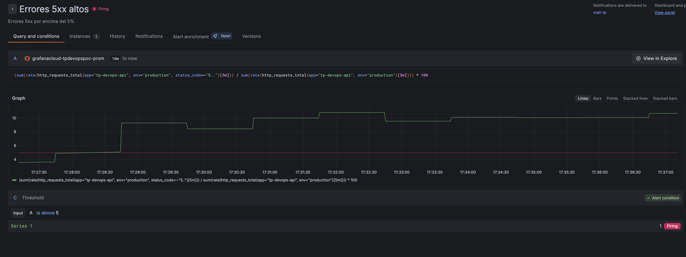
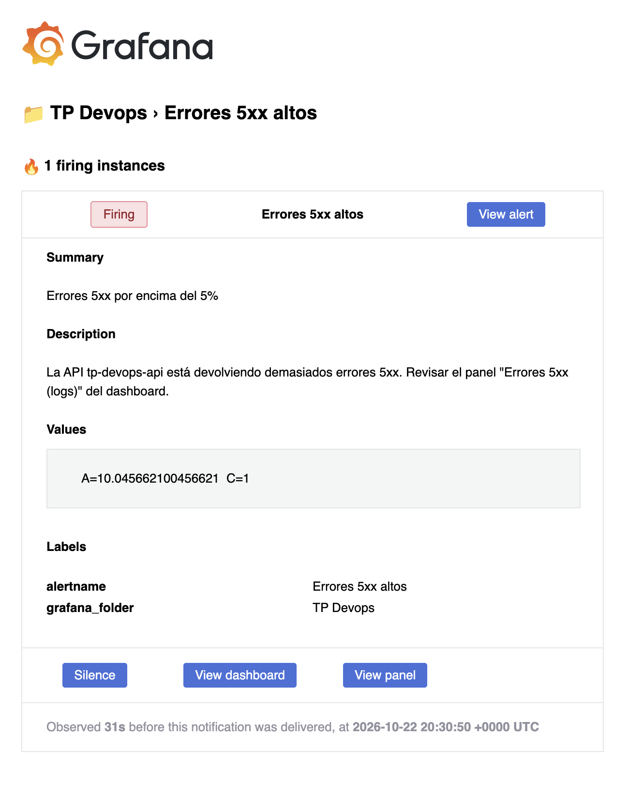

# TP Integrador DevOps — Ciclo de vida y despliegue continuo de una API

**Alumno:** Brian Grau

| | |
|---|---|
| Repositorio | https://github.com/graubrian/tp-devops-poc |
| API en producción | https://tp-devops-poc.onrender.com |
| Documentación (Swagger) | https://tp-devops-poc.onrender.com/docs |
| Imagen Docker | [`briangrau/tp-devops-poc`](https://hub.docker.com/r/briangrau/tp-devops-poc) |
| Releases | https://github.com/graubrian/tp-devops-poc/releases |

## 1. Resumen

API REST de tareas hecha con **NestJS** (TypeScript). La lógica de negocio es simple a propósito: el foco del trabajo es todo lo que la rodea.

- **Código y cambios:** GitHub Flow con Pull Requests obligatorios, Conventional Commits y versionado SemVer automático.
- **Empaquetado:** Dockerfile multi-stage sobre `node:24.22.0-alpine3.24`, usuario no root y `docker-compose` para desarrollo local.
- **CI/CD:** GitHub Actions con lint y tests como Andon Cord. Publica en Docker Hub con el tag SemVer y despliega en Render mediante un Deploy Hook que recibe la versión exacta.
- **Observabilidad:**
  - Logs JSON enviados a Grafana Loki.
  - Métricas Prometheus scrapeadas por Grafana Cloud.
  - Un dashboard propio con las Golden Signals.
  - Una alerta de errores 5xx por mail.

Para generar tráfico realista en la demo, la API tiene un **simulador de carga** (cron cada 5 s) que llama a sus propios endpoints con volumen variable. El volumen sigue una onda de ~10 min, con ruido y picos ocasionales, y mezcla respuestas 2xx, 4xx y 5xx.

### Endpoints

| Método | Ruta | Descripción |
|---|---|---|
| GET | `/` | Redirige a `/docs` |
| GET | `/docs` | Swagger UI (OpenAPI en `/docs-json`) |
| GET/POST | `/tareas` | Listar / crear tareas |
| GET/PATCH/DELETE | `/tareas/:id` | Ver / actualizar / borrar una tarea |
| GET | `/health` | Health check con `@nestjs/terminus` (memoria heap) |
| GET | `/metrics` | Métricas Prometheus (protegido con Bearer token) |
| GET | `/simulacion/inestable` | Endpoint con latencia y errores 5xx aleatorios (simula una dependencia externa) |

### Correr local

```bash
docker compose up          # desarrollo con hot reload en http://localhost:3000
docker compose --profile prod up api-prod   # misma imagen que producción, puerto 3001
make check                 # lint + tests + build (lo mismo que el CI)
```

Variables de entorno: ver [`.env.example`](.env.example).

---

## 2. Arquitectura del pipeline

### Diagrama de flujo



**Del merge a producción:** unos **2 min 20 s**, sin pasos manuales. Ejemplo real con v1.0.1: merge 03:54:08 → deploy pedido 03:56:24 (UTC).

### Componentes

| Etapa | Herramienta | Para qué |
|---|---|---|
| Control de versiones | Git + GitHub | Repositorio, PRs, protección de `main` (ruleset) |
| Linter | ESLint + Prettier | Calidad y estilo del código |
| Tests | Jest + Supertest | 8 tests unitarios + 8 e2e (incluye Swagger, health y métricas) |
| Runner de CI/CD | GitHub Actions | Workflows `ci.yml` (PR) y `release.yml` (main) |
| Versionado | semantic-release | Calcula SemVer desde Conventional Commits, crea tag y GitHub Release |
| Registro de imágenes | Docker Hub | `briangrau/tp-devops-poc:X.Y.Z` y `:X.Y` |
| Hosting | Render (plan Free) | Corre la imagen; se actualiza por Deploy Hook |
| Logs | pino → Grafana Loki | Logs JSON estructurados |
| Métricas | prom-client → Grafana Cloud (Prometheus) | Golden Signals |
| Dashboard y alertas | Grafana Cloud | Tablero propio + alerta de 5xx por mail |

### Workflows (modulares)

- **`.github/actions/setup-node`**: acción compuesta reutilizable que instala Node (versión de `.nvmrc`) con caché de npm y ejecuta `npm ci`. La usan todos los jobs.
- **`ci.yml`** se ejecuta en cada PR y además se puede reutilizar con `workflow_call`:
  - `Lint`, `Tests unitarios` y `Tests e2e` corren **en paralelo**.
  - `Build` construye la imagen de producción y corre solo si los tres anteriores pasan.
  - Los cuatro son **checks obligatorios** del ruleset de `main`.
- **`release.yml`** corre en cada push a `main` y encadena: reusa `ci.yml` → `Versionado SemVer` → `Publicar imagen` → `Deploy a Render`. Si un paso falla, los siguientes no corren.



---

## 3. Justificación técnica y decisiones de diseño

### 3.1 Optimización del contenedor

[`Dockerfile`](Dockerfile) con 5 etapas:

```
base   → node:24.22.0-alpine3.24, WORKDIR /app, USER node
deps   → COPY package.json package-lock.json + npm ci     (capa cacheable)
dev    → código fuente, npm run start:dev                 (lo usa docker-compose)
build  → código fuente, nest build, npm prune --omit=dev
prod   → solo dist/ + node_modules de producción + HEALTHCHECK
```

- **Imagen base:** `node:24.22.0-alpine3.24`, con versión exacta de Node y de Alpine, para builds reproducibles. Nunca usamos `latest`. Alpine es liviana y tiene menos paquetes, por lo tanto menos superficie de ataque. Node 24 es la LTS activa.
- **Multi-stage:** las herramientas de compilación (TypeScript, Nest CLI, Jest) quedan en `build`. La imagen final no tiene código fuente ni devDependencies: pesa **75 MB comprimida** y tiene 84 MB de `node_modules`.
- **Estrategia de capas:** primero se copian solo los manifiestos (`package.json`, `package-lock.json`) y se instalan las dependencias; recién después se copia el código. Al cambiar código, la capa de `npm ci` queda **CACHED** y solo se rehace la compilación. Además, el cache mount de BuildKit reutiliza la caché de npm entre builds, y en CI se usa la caché de GitHub Actions (`cache-from: type=gha`).
- **Seguridad:**
  - Corre con el usuario `node` (uid 1000), no con root. Verificado: `docker run ... whoami` devuelve `node`.
  - `.dockerignore` excluye `.git`, `.env`, `node_modules`, tests y documentación.
  - Los secretos nunca van como `build-args`, porque quedarían grabados en las capas de la imagen. Se inyectan como variables de entorno en Render.
- **Health check:** `HEALTHCHECK` sobre `/health` (terminus). El check es solo interno (memoria heap) para que la caída de un servicio externo no marque la app como caída.
- **Entorno idéntico:** `docker-compose.yml` tiene dos servicios:
  - `api` usa el target `dev`, con hot reload por volumen de `src/`.
  - `api-prod`, con el perfil `prod`, usa el target `prod`: la misma imagen que se publica.

### 3.2 Estrategia de integración

- **Branching:** **GitHub Flow**. `main` siempre está desplegable. Cada cambio va en una rama corta (`feat/...`, `fix/...`, `ci/...`, `docs/...`) y entra por Pull Request. Elegimos GitHub Flow sobre GitFlow porque es un equipo chico con despliegue continuo, y no hacen falta las ramas `develop` y `release`.
- **Protección de `main`** (ruleset `proteger-main`):
  - No se puede borrar la rama ni hacer force push.
  - Todo cambio entra por PR. Un push directo a `main` lo rechaza GitHub con `GH013: Repository rule violations`.
  - Checks obligatorios: `Lint`, `Tests unitarios`, `Tests e2e` y `Build`.
  - La rama del PR tiene que estar actualizada con `main` antes de mergear.
  - Solo **squash merge**, con el título del PR como mensaje. Así cada PR es un único commit Conventional en `main`.
- **Conventional Commits:** todos los commits siguen `tipo: descripción` (`feat`, `fix`, `ci`, `build`, `test`, `docs`, `chore`).
- **Versionado SemVer automático** con semantic-release:
  - `feat` sube la minor, `fix` sube el patch y `BREAKING CHANGE` sube la major.
  - `ci`, `build` y `docs` no generan release.
  - El tag sale del pipeline, nunca a mano.
  - Ejemplos reales: `v1.0.0` (primer release con `feat`) y `v1.0.1` (PR con título `fix`).
- **¿Por qué semantic-release y no release-please?** release-please abre su propio PR con el token del bot, y GitHub no dispara workflows desde PRs creados con `GITHUB_TOKEN`. Los checks obligatorios nunca correrían y ese PR quedaría bloqueado por el ruleset. semantic-release crea el tag directamente en el pipeline.
- **Trazabilidad:** la versión viaja de punta a punta, del tag `v1.0.1` a la imagen `:1.0.1`, de ahí a la variable `APP_VERSION` y de ahí al campo `version` en cada log y métrica. En el dashboard hay un panel **"Versión en producción"**.



---

## 4. Aplicación de la filosofía DevOps

### Primera Forma — Flujo y consistencia

**¿Qué tareas manuales quedaron 100% automatizadas?**

| Antes (manual) | Ahora (automático) |
|---|---|
| Correr lint y tests antes de integrar | CI en cada PR, con checks obligatorios |
| Decidir el número de versión | semantic-release lo calcula de los commits |
| Crear tag y notas de release | GitHub Release con notas generadas |
| `docker build` + `docker push` | Job `Publicar imagen` con tags `X.Y.Z` y `X.Y` |
| Entrar a Render y desplegar | Deploy Hook con `imgURL=...:X.Y.Z` |
| Instalar Node y dependencias para probar | `docker compose up` |

**¿Cómo se asegura que el entorno sea idéntico en desarrollo y en CI/CD?**
- La misma versión de Node (24) está en `.nvmrc`, la lee el CI (`node-version-file`) y es la base del Dockerfile.
- `npm ci` instala exactamente lo que dice `package-lock.json`, en local, en CI y en Docker.
- El job `Build` del CI construye **la misma imagen** que después se publica.
- `docker compose --profile prod up` corre esa imagen en local.
- Lo que se prueba es exactamente lo que se despliega (golden image inmutable por tag).

### Segunda Forma — Feedback rápido y Andon Cord

**¿En qué puntos el CI "corta el cable"?**

1. **Lint:** si hay errores de ESLint, falla el check.
2. **Tests unitarios y e2e:** si falla un solo test, falla el check.
3. **Build:** si el Dockerfile o la compilación TypeScript se rompen, falla. Solo corre si 1 y 2 pasaron.
4. **Ruleset de `main`:** con cualquiera de esos checks en rojo, GitHub **bloquea el botón de merge**.
5. **Release:** vuelve a correr el CI completo. Si falla, no se crea versión, no se publica imagen y no se despliega.

Feedback: el CI de un PR tarda unos 2 minutos y el resultado aparece en el mismo PR.

**Si la API empieza a responder 5xx o con latencia alta, ¿qué lo detecta y con qué señal?**

| Señal | Herramienta | Qué se ve |
|---|---|---|
| **Métrica** | Grafana Cloud (Prometheus) | Panel *Errores 5xx* (% sobre el total, verde/amarillo/rojo en 5% y 10%), *Errores por minuto* por status code, *Latencia p95* (umbrales 300/500 ms) |
| **Log** | Grafana Loki | Panel *Errores 5xx (logs)* con cada línea JSON `level: error`, `path`, `status_code`, `duration_ms` |
| **Alerta** | Grafana Alerting | Regla *Errores 5xx altos*: más de 5% de 5xx durante 2 min → mail al contact point `mail-tp` |



### Tercera Forma — Aprendizaje y simulación de fallos

#### Experimento 1: test unitario roto a propósito (Andon Cord en CI)

- **Qué hicimos:** en el [PR #6](https://github.com/graubrian/tp-devops-poc/pull/6) cambiamos una aserción de `tareas.service.spec.ts` (`expect(t1.id).toBe(99)` en lugar de `1`).
- **Cómo reaccionó el sistema:**
  - El job **Tests unitarios** falló y **Build** no llegó a correr.
  - El PR quedó marcado en rojo y GitHub bloqueó el merge por el ruleset.
  - Ningún artefacto defectuoso llegó a Docker Hub ni a producción. El PR se cerró sin mergear.



#### Experimento 2: la API empieza a devolver errores 5xx (monitoreo y alerta)

- **Qué hicimos:** en Render cambiamos `SIMULADOR_TASA_ERROR` de `0.05` a `1`. El endpoint `/simulacion/inestable`, que simula una dependencia externa, pasó a fallar siempre con 500/503.
- **Cómo reaccionó el sistema** (22/10, hora Argentina):

| Hora | Evento | Señal |
|---|---|---|
| 17:24 | Render reinicia la app con `SIMULADOR_TASA_ERROR=1` | — |
| 17:25 | Empiezan las respuestas 500/503 en `/simulacion/inestable` | **Log**: líneas `level: error` en Loki |
| 17:28:40 | La tasa de 5xx (ventana de 5 min) cruza el umbral de 5% | **Métrica**: panel *Errores 5xx* pasa de ~0.5% a ~10% |
| 17:28:40 → 17:30:50 | La regla queda en **Pending** (pending period de 2 min, evita falsas alarmas) | **Alerta** |
| 17:30:50 | La regla pasa a **Firing** con valor `A = 10.05%` | **Alerta** |
| 17:31 | Llega el mail **[FIRING:1] Errores 5xx altos**, con links al dashboard y al panel | **Notificación** |

- **Tiempo de detección:** unos **2 min desde que se cruza el umbral** hasta el aviso. Unos 6 min desde el cambio, porque la ventana de 5 min de `rate()` suaviza el comienzo.
- **Cierre:** al volver la variable a `0.05`, la tasa bajó, la regla volvió a **Normal** y Grafana mandó la notificación de resuelto.



*Dashboard durante la falla:*
- *Errores 5xx* en 9.97% (amarillo).
- *Errores por minuto* con las barras de 500/503 creciendo.
- *Latencia p95 por ruta* muestra que `/simulacion/inestable` es la ruta lenta.
- El panel de logs lleno de líneas `ERROR`.





#### Fallas reales que el sistema hizo visibles (aprendizaje)

- **"Funciona en mi máquina":**
  - El primer CI falló en `npm ci` porque el lockfile se había generado con npm 11 (local) y el runner usaba npm 10.
  - El Andon Cord lo frenó antes de `main`.
  - Solución: unificar la versión en Node 24 con `.nvmrc`, para local, CI y Docker.
- **Regresión de versión en producción:**
  - Los logs en Loki empezaron a decir `"version":"1.0.0"` cuando producción debía estar en 1.0.1.
  - Causa: el Deploy Hook despliega la imagen pedida, pero no cambia la imagen configurada en Render. Al cambiar una variable de entorno, Render redeployó la imagen vieja.
  - Lo detectamos gracias al campo `version` en logs y métricas.
- **Logs que no llegaban a Loki:**
  - Una prueba con `curl` devolvió `401 invalid scope requested`: el token era de solo lectura.
  - Aprendizaje: probar cada credencial de forma aislada antes de culpar al código.
- **"Not Found" en `/docs`:**
  - Mirando los headers apareció `x-render-routing: no-server`: era Render sin instancia activa durante un redeploy, no un bug de la API.

---

## 5. Principios Lean — reducción de desperdicio

| Desperdicio (muda) | Cómo se manifestaba | Cómo lo evita la solución |
|---|---|---|
| **Esperas / demoras** | Compilar, armar la imagen, subirla y desplegar a mano tomaba varios minutos de atención humana por cambio | El pipeline lleva un merge a producción en ~2 min 20 s sin intervención. La caché de capas Docker y de npm acorta los builds |
| **Defectos detectados tarde** | Bugs que se descubren en producción | Lint + 16 tests + build en cada PR, con merge bloqueado si fallan. La alerta de 5xx detecta en minutos lo que se escape |
| **Configuración manual / re-aprendizaje** | "¿Qué versión de Node? ¿Cómo lo levanto?" | `.nvmrc`, `docker compose up`, `makefile`, `.env.example` y Swagger en `/docs`: el entorno y la API se autodocumentan |
| **Traspasos (handoffs)** | Dev entrega a Ops para desplegar | El mismo PR que cambia el código termina desplegado. "You build it, you run it" |
| **Trabajo parcialmente hecho** | Ramas largas sin integrar | PRs chicos de una sola idea, integrados el mismo día (small batches) |

---

## 6. Estructura del repositorio

```
src/
  tareas/        CRUD de tareas (controller, service, DTOs)
  health/        /health con terminus
  metrics/       prom-client: middleware, /metrics
  logging/       pino + envío a Loki
  simulacion/    simulador de carga (cron) y endpoint inestable
test/            tests e2e
.github/
  workflows/     ci.yml, release.yml
  actions/       setup-node (acción compuesta)
Dockerfile, docker-compose.yml, makefile, .releaserc.json
```
